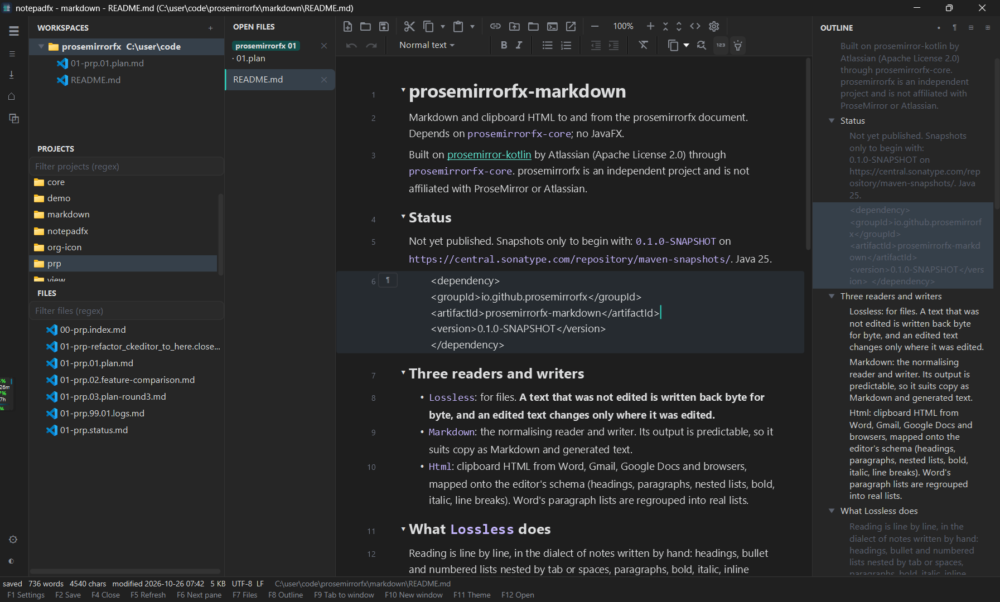

# notepadfx

A fast markdown and text editor for the desktop, in JavaFX.

*Screenshot of notepadfx 0.1.2, taken 2026-10-26. When the app looks different from this, take a new one and name it after the version shown.*

- Workspaces, with a projects pane and a files pane, each with a regex filter.
- Vertical tabs that show the whole file name, wrapped.
- An outline of the open file (headings, bullets and paragraphs) that wraps long entries and follows the caret.
- Several windows in one process. Launching notepadfx again opens a new window in the running process; a tab can be dragged out into its own window, or between windows.
- Keyboard first: every action is on a function key, and the legend along the bottom is clickable.
- Light and dark themes.

Markdown files open in the prosemirrorfx editor (WYSIWYG, saved losslessly); other text files in a plain editor.

## Keys

F2 save, F4 close tab, F5 refresh, F6 next pane, F7 files panes, F8 outline, F9 move tab to a new window, F10 new window, F11 theme, F12 open. Ctrl+Tab and Ctrl+PageUp/PageDown move between tabs.

## Install and update

Download `notepadfx.exe` from the latest release, then run `notepadfx install`: it goes to your user programs folder, on PATH, with Start Menu and Desktop shortcuts. `notepadfx update` updates it; the app also checks once a day and offers the update in its status bar. Install also adds "Open with notepadfx" to Explorer's right-click menu for files and folders; `notepadfx explorer-menu off` (or Settings) removes it.

## Build

Java 25 and Maven. `mvn verify` builds `target/notepadfx.jar` and `target/jr/notepadfx.exe` (a jarrunner launcher with the JVM in-process and an AOT cache).

State lives in `~/prosemirrorfx/notepadfx/session.json`.
